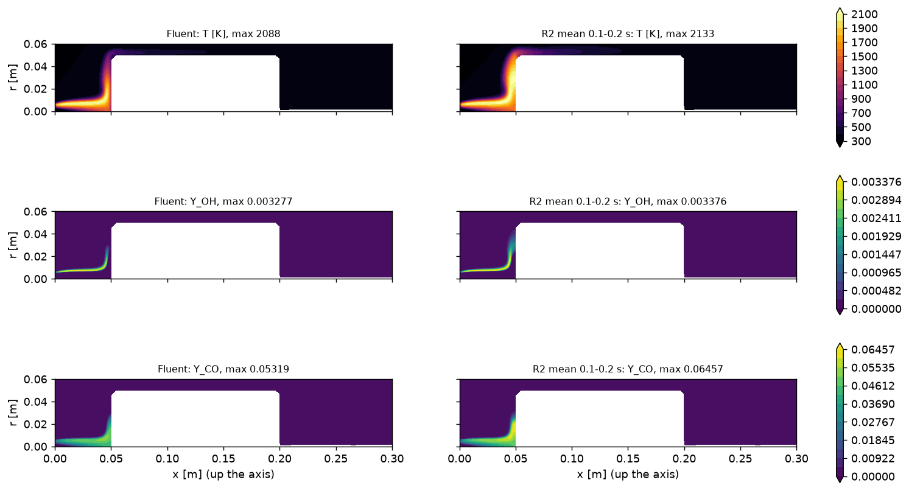
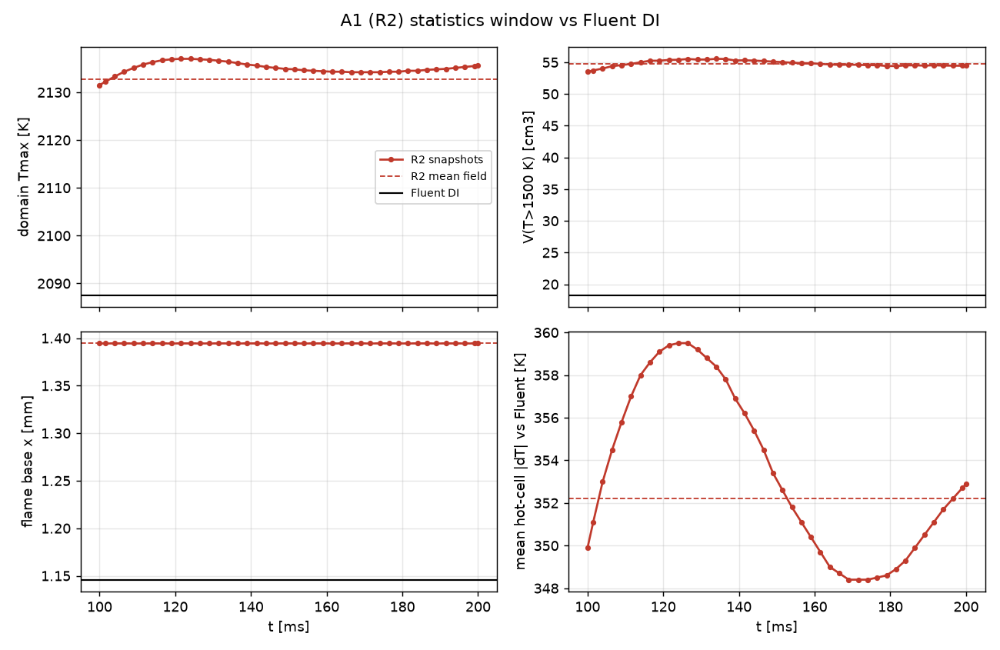
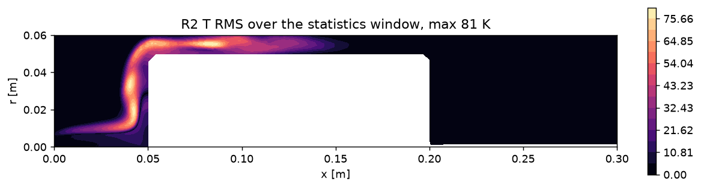

# Gate G1: is the OpenFOAM reference flame (R2) the Fluent flame?

10 Nov 2026, 13:30 CET. Run A1 on sim1. Decision needed from Javier (section 6).

**Answer: no. G1 fails on hot volume and mean |dT|.** The cause has been found, and it is not the species
transport. The Fluent case runs DO radiation with a transparent gas. Its "adiabatic" pot bottom therefore
radiates away about 45 % of the burner's heat release, which it takes from the gas underneath by convection.
The OpenFOAM case has no radiation, so the gas under the pot bottom stays 600-1100 K hotter. That hot layer
is most of the extra hot volume.

## 1. What was run

| Item | Setting |
|---|---|
| Case | corrected outlets (top `outlet-lab` and chimney `wall-fff-fluid-exhaust` open, r = 0.14 m side a wall); mesh from `quemadorUnicoTesis_60KCells-GA18--ID.cas.h5` (63,087 cells, 5 deg wedge) |
| Solver | `rhoReactingBuoyantLeFoam`, `constantLewis` (per-species Le, Sct 0.7), kOmegaSST, GA18 DI (seulex, rtol 1e-5, atol 1e-10) |
| Start | converged Fluent DI field (`.dat.h5`, 8572 it) mapped cell by cell (`fluent_dat_to_foam.py`) |
| Time stepping | Euler, fixed dt 2e-5 s, PIMPLE 1 outer / 2 correctors, 0 to 0.2 s (10,000 steps) |
| Statistics | `fieldAverage` mean and prime2Mean of T, U and all 18 Y over 0.1-0.2 s; 42 snapshots kept, every 2.5 ms; `tauCellHistogram` on |
| Cost | 9 Nov 23:11 to 10 Nov 12:40 CET. 12 ranks at 5.1 s/step to 64 ms, then 16 ranks at 4.5 s/step. No crashes |

Run directory on sim1: `/opt/ofb/runs/A1_R2` (mean fields in `processor*/0.2`, snapshots in `processor*/0.1*`).

## 2. Result against the G1 criteria

| Criterion (roadmap section 4) | Fluent DI | R2 mean 0.1-0.2 s | Limit | Verdict |
|---|---|---|---|---|
| Tmax | 2087.5 K | 2132.7 K (+45 K) | within 50 K | pass (just) |
| V(T > 1500 K) | 18.25 cm3 | 54.8 cm3 (x3.0) | within 30 % | **fail** |
| Flame base (lowest x with T > 1500 K) | 1.15 mm | 1.39 mm | within 3 mm | pass |
| Mean hot-cell abs(dT) vs Fluent | - | 352 K (volume-weighted 522 K) | under 100 K | **fail** |
| Flame stable over the window | - | V 53.5-55.5 cm3, base constant, T RMS at most 81 K | no drift | pass |

Other metrics (mean field): OH max 0.00338 vs 0.00328, CO max 0.0646 vs 0.0532. x(OH max) is 44.4 mm vs 15.1 mm, and
the axis Tmax is 1506 K at the pot bottom vs 1437 K at 46 mm.

The jet flame up to x of about 40 mm is close to Fluent's: the flame base, the OH sheet and Tmax all match. The difference is the
gap under the pot (x 40-50 mm, r 10-47 mm). There the R2 flame fills the gap with gas above 1900 K and runs up the
pot bottom, while Fluent's gas against the pot bottom is 780-1190 K.

The flame is settled over the whole window. V(T > 1500) stays at 54.8 +- 1 cm3, and the base does not move. There
is a slow oscillation with a period of about 90-100 ms (about 10 Hz; mean abs(dT) 348-360 K), probably the buoyant
mode. Its amplitude is small: T RMS at most 81 K, along the sheet under the pot and at the hood exit.

How it got there (instantaneous fields, `A1/progress.csv`): V(T > 1500) went 18.2 (Fluent start), then 29.5 (20 ms),
44.7 (62 ms), 52.6 (94 ms) and 55 cm3 (from about 120 ms on). The PC thread's LTS run went the same way (58 cm3 at
iteration 3000), so local time stepping is not the cause.

## 3. Diagnosis: Fluent's wall radiation is missing in OpenFOAM

I checked the settings stored in the corrected `.cas.h5` and the face data in the `.dat.h5`:

- **Fluent has DO radiation on, with a transparent gas** (`absorption-coefficient constant 0`, DO intensities
  present, irradiation 2-90 kW/m2). The gas does not emit or absorb, but the walls exchange radiation with each other
  and with the openings.
- **The pot bottom over the gap (`wall-pot-fff-fluid-fuel`) is a zero-heat-flux wall in both solvers.** In Fluent, the
  zero applies to the total flux. Its face data give total flux 0 and radiative flux +25.1 W per radian, so
  the wall radiates 25 W/rad away and takes the same 25 W/rad from the gas by convection. The fuel inflow is
  1.07e-6 kg/s per radian (6.735e-6 kg/s in total), which at 50 MJ/kg is about 54 W per radian. **The pot bottom removes about 45 % of
  the heat release.**
- Fluent's pot-bottom wall temperature is 643-921 K (mean 823 K). In OpenFOAM this wall is `zeroGradient`
  (truly adiabatic, nothing radiated), so the gas against it stays at flame temperature.
- Gas temperature in the first 2 mm under the pot bottom (x 48-50 mm):

| r (mm) | Fluent T (K) | R2 mean T (K) |
|---|---|---|
| 5-10 | 1149 | 1610 |
| 10-20 | 1188 | 1797 |
| 20-30 | 1130 | 2062 |
| 30-40 | 919 | 2002 |
| 40-47 | 778 | 1724 |

- Smaller radiative flows on the other walls, per radian: pot side (mixing) +3.2 W, pot exhaust side +1.3 W, disk
  -12.2 W (absorbs, fixed at 300 K), side wall `outlet-lab:026` -5.0 W, hood -1.8 W.

Other differences found, which can only be second-order next to the 25 W sink:

- Fluent has thermal (Soret) diffusion on (`species/thermal-diffusion? #t`).
- Fluent adds buoyancy production to SST (`turbulence/buoyancy-effects-option 1`).
- OpenFOAM's omega was clipped ("bounding omega") in about 8,000 of the 10,000 steps. Turbulence is weak in this flame (nut 1e-9 to 1e-6 m2/s
  near the pot), so this matters little.
- Constant-Le vs Fluent's kinetic-theory mixture diffusion. This was the roadmap's suspect; the radiation sink
  is a far larger effect.

The same missing sink also affects A2, the ignition reference: there the pot bottom heats up during the first
25 ms. The PC thread's LTS LeFoam run has the same case setup, so it lacks radiation too.

## 4. A2 and A3 (for completeness)

- **A2** (ignition DI from the lean start, 4 ranks, 0-25 ms): ignition (domain Tmax > 1600 K) at 2.4 ms. Tmax is
  2098 K at 5 ms and 2134 K at 25 ms. 18 snapshots plus CSVs. `results/sim1/A2/summary.md`.
- **A3** (2-step LeFoam LTS flame plus stage 19): settled at 4000 iterations. Stage 19 gate against R2's DI statistics at
  0.2 s (`scripts/19_flow_statistics.py compare --ref R2_DI_0.2`, factor 2 on p1/p50/p99):

| Check | Result | p1 | p50 | p99 |
|---|---|---|---|---|
| chi at Z_st | pass | x1.13 | x1.40 | x1.27 |
| tau_cell (T > 600 K) | pass | x0.94 | x1.22 | x0.83 |
| strain at Z_st | pass | x1.02 | x0.99 | x0.85 |
| psi (heat loss) | fail | +0.036 | +0.061 | +0.106 |
| age at Z_st | n/a (A1 has no age function object) | | | |

  R2's own hot tau_cell is 10 us (p1), 75 us (p50) and 238 us (p99). These are statistics of a flame that, per section 3, lacks
  the wall heat sink. They should be redone on the corrected reference before they drive the tix2 exploration (C1).

## 5. Notes for protocol v2

- R2's kept snapshots are at **0.1015, 0.104, 0.1065, ... 0.199 s and 0.2 s**: every 2.5 ms, but 1.5 ms off round
  times. The step counter restarted when A1 moved from 12 to 16 ranks at 64 ms. The states at 0.1 s and 0.2 s
  were also kept. Candidate runs from the 0.1 s state need their first write after 75 steps, then every 125.
- `rhoReactingBuoyantLeFoam` needed the MPI and OpenFOAM library dirs on `LD_LIBRARY_PATH`. This is fixed in
  `server/setup_server.sh`.
- Decomposition: cell weight 5 for T > 500 K (`results/sim1/S3/scaling.md`).

## 6. Decision for Javier

None of the R2 fields should be used as the reference for scoring. Options:

1. **Recommended: add the missing wall radiation, then rerun the reference (A1c).**
   - *Quick check first (about 6 h on 16 ranks):* take R2 at 0.2 s and impose Fluent's own wall temperatures on the pot
     walls (`wall-pot-fff-fluid-fuel/-mixing/-exhaust`, from the `.dat.h5` face data). Run until settled. If V(T > 1500)
     falls toward 18 cm3 and the gap temperatures match, the diagnosis is confirmed. This is a check, not the final
     reference: fixed wall temperatures are wrong during ignition and for other surrogates' flames.
   - *Then the real fix:* radiation in OpenFOAM to match Fluent: `fvDOM` with zero gas absorption, wall emissivity as
     in the `.cas` (to be read), radiative-flux-aware wall BCs (`externalWallHeatFluxTemperature` with `qr`).
     fvDOM on a 5 deg wedge needs a test first. Then rerun A1 (about 12 h) and A2 (about 2.5 h).
2. **Move OpenFOAM scoring to Fluent** (roadmap "fail, far"). This keeps sim1 for exploration and training. It is not
   needed if option 1 works.
3. **Accept R2 as a different but self-consistent reference** (same flame base, no radiation) and rank surrogates on it.
   The ranking would then not transfer to Fluent, so I don't recommend it.

Until the decision, sim1 is idle (16 cores free). Nothing in phases B-E has been started.

Material: `results/sim1/A1/G1/` (`compare_mean.png`, `snap_0.2.png`, `drift.png`, `drift.csv`, `T_rms.png`),
`results/sim1/A1/progress.csv`. Scripts: `server/sim1/g1_report.sh`, `g1_figures.py`.
