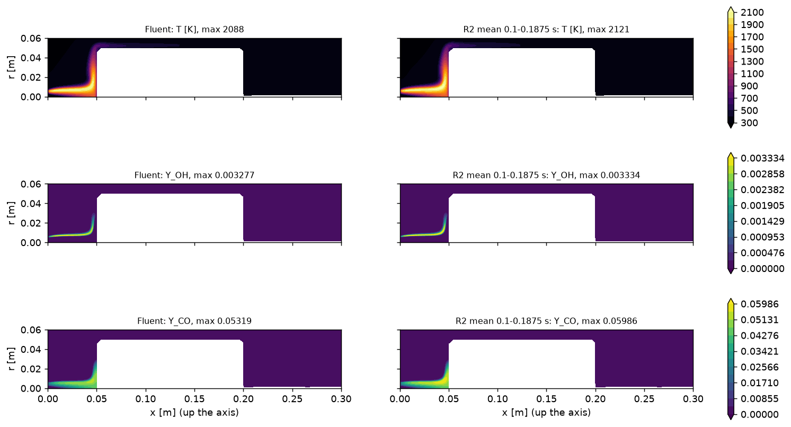
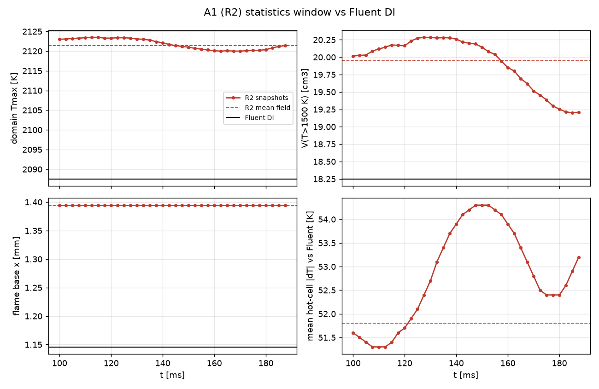

# Gate G1, second try: R2 with wall radiation (A1r)

11 Nov 2026, 15:25 CET, sim1. Pre-approved by Javier ("start phase B if it passes").

**Verdict: pass.** Over the statistics window 0.1-0.1875 s, the mean field of the OpenFOAM reference with Fluent's wall
radiation meets all G1 limits. Phase B started at 15:20 CET. There are two deviations from the plan (window 87.5 ms instead of
100 ms; a radiation-solver stall after about 0.15 s, fixed for phase B). They are explained in section 3.

## 1. What changed since the first G1 (`results/sim1/A1/G1.md`)

The first reference (R2, A1) failed with 3x Fluent's hot volume. The cause was that the OpenFOAM case had no wall radiation.
Fluent radiates heat away from its pot bottom: DO radiation, transparent gas, black walls, about 45 % of the heat release.
- Wall-temperature check (`results/sim1/A1w/wall_T_check.md`): with Fluent's pot-wall temperatures imposed, V(T>1500)
  fell from 54.5 to 28 cm3 in 14 ms. That confirmed the diagnosis.
- Fix (`openfoam/quemadorUnico/enable_radiation.sh`): fvDOM, no gas absorption, black boundaries, and zero total flux
  (convection + qr) on Fluent's zero-flux walls. Validated on the Fluent field: pot-bottom radiative loss 27.1 vs 25.1 W/rad,
  pot-bottom wall 646-927 K vs Fluent 643-921 K.
- A1r = A1 with that radiation: same Fluent start, LeFoam + constantLewis, GA18 DI, Euler dt 2e-5 s, 8 ranks at 7.6 s/step,
  fieldAverage of T, U and 18 Y from 0.1 s, snapshots every 2.5 ms (on round times).

## 2. Result

| Criterion | Fluent DI | A1r mean 0.1-0.1875 s | Limit | Verdict |
|---|---|---|---|---|
| V(T > 1500 K) | 18.25 cm3 | 19.95 cm3 (+9.3 %) | within 30 % | pass |
| Tmax | 2087.5 K | 2121.4 K (+34 K) | within 50 K | pass |
| Flame base (lowest x with T > 1500 K) | 1.15 mm | 1.39 mm (one cell) | within 3 mm | pass |
| Mean hot-cell abs(dT) vs Fluent | - | 51.8 K (volume-weighted 51.8 K) | under 100 K | pass |
| Stable over the window | - | V 19.2-20.3 cm3, base fixed, Tmax 2120-2124 K, T RMS at most 58 K | no drift | pass (see below) |

Other mean-field metrics: OH max 0.00333 vs 0.00328, CO max 0.0599 vs 0.0532, x(OH max) 15.9 vs 15.1 mm, axis Tmax 1472 vs 1437 K.
The first R2 had 54.8 cm3, 352 K and x(OH max) 44 mm.

How it got there (`A1r/progress.csv`): V(T>1500) was 18.4 cm3 at 16 ms, 19.0 at 32, 19.6 at 50, 20.0 at 70-150 ms. It drifted
down to 19.2 cm3 between 150 and 187.5 ms, which coincides with the radiation stall below.

## 3. Deviations

1. **Hood baffle crash (05:45 CET).** The radiation-coupled thin baffle (`turbulentTemperatureRadCoupledMixed` on both
   sides of the zero-thickness hood) cooled the chimney gas next to it without bound (min T 52 K, FPE at 0.124 s). The hood
   is now a plain coupled baffle without qr; Fluent's net hood radiation is only +-1.8 W/rad. I restarted from 0.1 s and
   deleted the 0.1025-0.1225 s snapshots, so the statistics window restarted at 0.1 s.
2. **Radiation-solver stall, run stopped at 0.18778 s (15:05 CET).** The fvDOM ray solver had tolerance 1e-4, and from
   about 0.15 s the ray residuals sat at 1.0e-4, so GAMG did no iterations and the intensities froze. The wall-emission
   terms kept following the wall temperature, so qr became noisy near the axis (+-120-180 kW/m2 face to face on the pot
   bottom at r < 1 mm; it was smooth at -37 kW/m2 at 0.1 s). At 0.18754 s the gas cell on the axis under the pot bottom ran
   away (295 -> 204 K in 4 steps, then clipped at 200 K). I stopped the run before the next write. **0.1875 s is the last
   clean state**, so the statistics window is 0.1-0.1875 s (87.5 ms, 36 snapshots).
   - Fix (in `enable_radiation.sh` and the phase B bases): ray solver tolerance 1e-6, relTol 0.01, fvDOM outer tolerance
     1e-6, so all 3 sweeps per solve always run.
   - Phase B scores against A1r 0.1-0.15 s. The ray residuals there were 1.1-3.8e-4 (above the old tolerance), so the
     rays were still being solved in that window.
   - The near-axis behaviour of fvDOM on a wedge should still be watched: the shadow/OOD and min-T checks of every
     phase B run will show it.
3. **Side-wall cold drift.** The cell next to the r = 0.14 m side wall near the floor cooled slowly, 300 -> 295.6 K over
   0.19 s. This is the fvDOM over-estimate of that wall's exchange (11 vs Fluent's 5 W/rad). It is harmless for the flame.

## 4. A2r and the phase B inputs

- A2r (ignition DI with radiation, lean start, 4 ranks): ignition (domain Tmax > 1600 K) at 2.4 ms, Tmax 2098 K at 5 ms and
  2134 K at 25 ms. This is identical to A2 without radiation; the walls do not matter in the first 25 ms. 18 snapshots.
- Protocol v2 (`openfoam/protocol/run_protocol_v2.sh`, `protocol_v2_ign.yaml`, `protocol_v2_flame.yaml`, `score_v2.py`):
  - ignition phase: lean start, 0-25 ms, vs A2r;
  - flame phase: from A1r at 0.1 s, 50 ms, vs the A1r snapshots;
  - S = max(F, I, C) with the `rules.py` targets.
- Smoke test (`results/sim1/smoke_rad/summary.md`): ood8_s0 pure, 500 steps, no crash, 2.2 s/step. OOD 25 % on the
  radiation-cooled lean gas.

## 5. A3r statistics gate

Pending (A3r and the A1r stage 19 statistics are still running); added below when done.
