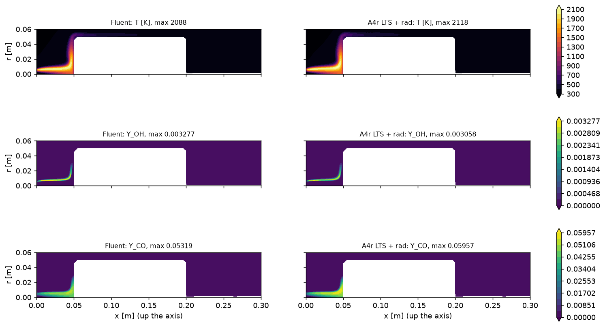

# A4r: steady LTS GA18 + LeFoam/constantLewis + wall radiation vs Fluent

2026-11-15 05:11 CET, sim1, 8 ranks. Stopped at iteration 3000 (2026-11-15 05:11:05 CET settled at 3000).

Progress (iteration, V(T>1500 K) cm3, Tmax K): `progress.csv`. PC run without radiation, for reference:
settled at V 60.1 cm3, Tmax 2126 K. A1r (DI + radiation) mean 0.1-0.1875 s: V 19.95 cm3, Tmax 2121 K, base 1.39 mm.

```
metric                                     Fluent A4r LTS + rad
Tmax [K]                                   2087.5       2117.7
x(Tmax) [mm]                               42.855       43.354
r(Tmax) [mm]                               8.8673       9.8661
axis Tmax [K]                              1437.4       1474.9
x(axis Tmax) [mm]                          46.374       46.374
flame length T>1500 on axis [mm]              nan          nan
flame base x T>1500 [mm]                   1.1459       1.3947
hot volume T>1500 [cm3]                    18.248       19.623
OH max                                  0.0032769    0.0030582
CO max                                   0.053188     0.059569
x(OH max) [mm]                             15.125       10.875
Ux max [m/s]                                1.398       1.3938

cell-by-cell T difference (A4r LTS + rad - Fluent): mean |dT| in hot cells 47.6 K, volume-weighted 40.6 K, max |dT| 242 K
saved cmp_3000.png
```



## Verdict (G1 limits against Fluent DI)

| Metric | Fluent DI | A4r LTS + radiation, it 3000 | A1r DI + radiation, mean 0.1-0.1875 s | PC LTS without radiation | Limit | Result |
|---|---|---|---|---|---|---|
| V(T > 1500 K) | 18.25 cm3 | 19.62 cm3 (+7.5 %) | 19.95 cm3 | 60.1 cm3 | within 30 % | pass |
| Tmax | 2087.5 K | 2117.7 K (+30 K) | 2121 K | 2126 K | within 50 K | pass |
| Flame base | 1.15 mm | 1.39 mm | 1.39 mm | - | within 3 mm | pass |
| Mean hot-cell abs(dT) | - | 47.6 K | 51.8 K | - | under 100 K | pass |

Convergence (`progress.csv`): it 1000 V 20.70 / Tmax 2119.4; it 2000 19.11 / 2117.5; it 3000 19.62 / 2117.7. The
change from it 2000 to 3000 was 2.7 % and 0.2 K, which met the settle rule (< 3 %, < 10 K). Cost: 8 ranks, about 21 s
per LTS iteration, 17.6 h (14 Nov 11:35 to 15 Nov 05:11 CET). Prepared case: `/opt/ofb/runs/s3/base_rad2` (Fluent DI
field + current `enable_radiation.sh`: hood non-radiative, ray tolerance 1e-6), cold radiation start.

**With Fluent's wall radiation, the steady LTS LeFoam flame reproduces both Fluent and the time-accurate A1r mean.**
The PC's LTS run without radiation had drifted to 3.3x Fluent's hot volume, so radiation is the missing piece for LTS
too. Consequence: the steady test 6b can be rebuilt on an LTS state. A reference check then costs about 17 h on 8 cores
(or less from a nearby state) instead of a day of time-accurate DI. The last 3000-iteration state is in
`/opt/ofb/runs/A4r_lts/processor*/3000`.
