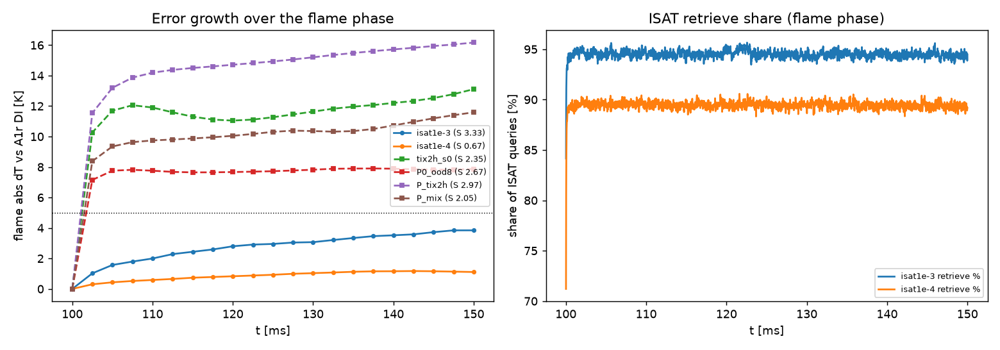

# E2: ISAT vs networks over the full protocol v2 (longer run)

Same case, radiation and scoring for every row: ignition phase 0-25 ms against A2r (GA18 DI), flame phase 50 ms from the A1r state at 0.1 s against the A1r DI snapshots 0.1-0.15 s. 4 ranks. ISAT = OpenFOAM TDAC, no mechanism reduction, GA18 seulex for the direct integrations. Networks: the phase B / C4 runs (same protocol, pure mode). S = max(F, I, C), 1 = target (flame abs dT 5 K, ignition 0.3 ms, CO/OH x1.4).

| Method | S | F (flame abs dT) | I (ignition shift) | C | drift [K/10 ms] | L1 OH / CO (flame) | V(T>1500) xDI | s/step (flame) | chemistry share |
|---|---|---|---|---|---|---|---|---|---|
| isat1e-3 (ISAT) | **3.33** | 0.57 (2.9 K) | 3.33 (-1.0 ms) | 0.03 | +0.5 | 2.6 % / 0.7 % | 1.007 | 2.96 | 55 % |
| isat1e-4 (ISAT) | **0.67** | 0.18 (0.9 K) | 0.67 (-0.2 ms) | 0.01 | +0.2 | 0.8 % / 0.3 % | 0.998 | 3.65 | 64 % |
| tix2h_s0 (network) | **2.35** | 2.35 (11.8 K) | 2.00 (+0.6 ms) | 1.34 | +0.3 | 31.9 % / 66.2 % | 0.996 | 1.99 | 34 % |
| P0_ood8 (network) | **2.67** | 1.55 (7.8 K) | 2.67 (-0.8 ms) | 0.48 | +0.1 | 18.3 % / 4.4 % | 0.999 | 4.09 | 68 % |
| P_tix2h (network) | **2.97** | 2.97 (14.9 K) | 0.67 (+0.2 ms) | 0.61 | +0.7 | 23.4 % / 6.8 % | 0.995 | 3.95 | 67 % |
| P_mix (network) | **2.05** | 2.05 (10.3 K) | 2.00 (-0.6 ms) | 0.50 | +0.5 | 18.9 % / 5.9 % | 0.995 | 7.12 | 81 % |

## Flame abs dT against A1r over the 50 ms (K, flame cells T > 1600 K)

| t [ms] | isat1e-3 | isat1e-4 | tix2h_s0 | P0_ood8 | P_tix2h | P_mix |
|---|---|---|---|---|---|---|
| 102.5 | 1.0 | 0.3 | 10.3 | 7.2 | 11.5 | 8.4 |
| 110.0 | 2.0 | 0.6 | 11.9 | 7.8 | 14.2 | 9.7 |
| 120.0 | 2.8 | 0.8 | 11.0 | 7.7 | 14.7 | 10.0 |
| 130.0 | 3.1 | 1.0 | 11.6 | 7.8 | 15.2 | 10.4 |
| 140.0 | 3.5 | 1.2 | 12.2 | 7.9 | 15.7 | 10.7 |
| 150.0 | 3.8 | 1.1 | 13.1 | 7.9 | 16.2 | 11.6 |

## ISAT table over the flame phase (summed over the 4 ranks)

| run | t [ms] | table size (leaves) | retrieve | grow | add |
|---|---|---|---|---|---|
| isat1e-3 | 100.02 | 521 | 84.2 % | 14.0 % | 1.82 % |
| isat1e-3 | 101.00 | 1346 | 94.4 % | 5.1 % | 0.47 % |
| isat1e-3 | 105.00 | 1204 | 95.0 % | 4.6 % | 0.39 % |
| isat1e-3 | 110.00 | 1322 | 94.4 % | 5.1 % | 0.47 % |
| isat1e-3 | 125.00 | 1268 | 94.3 % | 5.2 % | 0.51 % |
| isat1e-3 | 150.00 | 1229 | 94.5 % | 5.1 % | 0.43 % |
| isat1e-4 | 100.02 | 1163 | 71.2 % | 25.2 % | 3.60 % |
| isat1e-4 | 101.00 | 2834 | 89.4 % | 9.7 % | 0.87 % |
| isat1e-4 | 105.00 | 2928 | 89.3 % | 9.9 % | 0.86 % |
| isat1e-4 | 110.00 | 2903 | 89.1 % | 9.9 % | 0.93 % |
| isat1e-4 | 125.00 | 2919 | 90.3 % | 8.9 % | 0.78 % |
| isat1e-4 | 150.00 | 2788 | 89.2 % | 9.9 % | 0.92 % |

## Findings

1. **ISAT at tolerance 1e-4 meets every protocol v2 target (S 0.67), the first method in this project to do so.**
   Flame abs dT 0.9 K (0.3-1.2 K over the 50 ms, drift +0.2 K/10 ms), ignition 0.2 ms early (target 0.3 ms), L1 OH/CO
   0.8 % / 0.3 %. Cost 3.65 s/step on 4 ranks (ignition phase 3.9): about 3.7x faster than GA18 DI (13.6 s/step) on the
   whole step, cheaper than the 3-member ensembles (4.0-4.1 s/step).
2. **ISAT 1e-3 is accurate in the flame but fails ignition** (flame 2.9 K, F 0.57; ignition 1.0 ms early, S 3.33). The
   induction chemistry needs the tighter table, as the networks do.
3. **The networks are 3-15x less accurate in the flame than ISAT 1e-4.** Their best flame error is P0's 7.8 K (flat over
   time); P_mix and tix2h_s0 start at 8-10 K and grow to 12-13 K at 150 ms. ISAT 1e-3 also grows (1.0 -> 3.8 K).
   Only P_tix2h meets the ignition target among the networks (+0.2 ms), and no network meets all three targets
   (best S 2.05, P_mix).
4. **ISAT's table settles in under 1 ms of simulated time and stays small** (1e-3: about 1,250 leaves over 4 ranks,
   94-95 % retrieves; 1e-4: about 2,900 leaves, 89-90 % retrieves, 9-10 % grows, under 1 % adds), so the cost is
   steady over the run. It would be higher for a flame that moves through composition space faster, or for a much
   larger mechanism (GRI-3.0: 54-dimensional table).
5. **Consequence for the surrogate work (C2/C3):** on this case the bar is now ISAT 1e-4: S 0.67 at 3.65 s/step. A
   network or ensemble pays off only if it reaches that accuracy at a clearly lower cost (a single network costs about
   2.0 s/step, 3 members about 4 s/step). The C2 ignition coverage and the C3 ITERML iterations should be judged
   against it.

Caveats: one run per tolerance (ISAT is deterministic up to rank-dependent table contents); the machine also ran C2's
trainings (7 threads), so s/step carries load, as in phase E.
